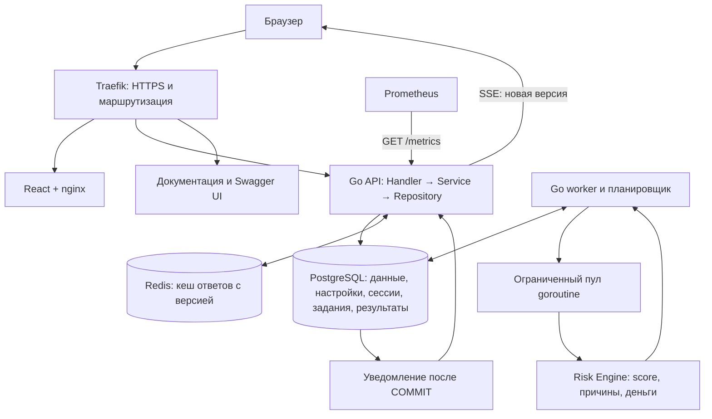

# HackAeza

Анализатор рисков оттока клиентов хостинг-провайдера. Проект команды «Шторм Z» для кейса Aéza.

Панель помогает маркетологу найти клиентов под риском, увидеть причины оценки и стоимость ближайших продлений. Доступны рейтинг с поиском, фильтрами и сортировками, карточка клиента, настройки модели, импорт JSON-снимка и график сценарных непродлений. Результаты вычисляются из загруженных данных.

## Стек

| Компонент | Реализация |
| --- | --- |
| Frontend | React, TypeScript, Vite, TanStack Query |
| Backend | Go, Gin, Zap |
| Хранение | PostgreSQL 17, pgx |
| Очередь | Задания и lease в PostgreSQL, отдельный Go worker |
| Кеш | Redis 7.4, ключи с версией расчёта |
| Маршрутизация и HTTPS | Traefik, Let's Encrypt на VPS |
| Миграции | Goose |
| API-документация | OpenAPI YAML, Swagger UI и отдельный интерфейс документации |
| Мониторинг | Prometheus, метрики Go и приложения |
| Запуск | Docker Compose, Task v3 |

## Чистая установка

Нужны Git, Docker Engine с Compose и Task v3. Go, Node.js, PostgreSQL и Redis на хост устанавливать не требуется: приложение собирается и работает в контейнерах. Пользователь запуска должен иметь доступ к Docker. Порты 80 и, для VPS, 443 должны быть свободны.

Для чистого демонстрационного сервера Ubuntu 24.04 LTS выполните от root:

```sh
apt-get update
apt-get install -y ca-certificates curl git
curl -fsSL https://get.docker.com -o /tmp/install-docker.sh
sh /tmp/install-docker.sh
systemctl enable --now docker
curl -fsSL https://taskfile.dev/install.sh -o /tmp/install-task.sh
sh /tmp/install-task.sh -b /usr/local/bin

docker compose version
task --version
```

Другие способы установки: [Docker Engine](https://docs.docker.com/engine/install/), [Task](https://taskfile.dev/docs/installation).

Склонируйте публичный репозиторий по HTTPS; SSH-ключ для клонирования не нужен:

```sh
git clone https://github.com/sklyar-vlad/HackAeza.git
cd HackAeza
```

Все дальнейшие команды выполняются из корня репозитория.

### Локальный запуск

```sh
task up
```

Откройте http://aeza.localhost. Если система не разрешает этот адрес, добавьте `127.0.0.1 aeza.localhost` в файл hosts.

### Запуск на VPS

DNS-запись `aeza.fabulosus.online` должна указывать на адрес VPS. Порты 80 и 443 должны быть доступны извне для HTTP-проверки Let's Encrypt и HTTPS.

```sh
task vps-up
```

Откройте https://aeza.fabulosus.online. Traefik перенаправляет HTTP на HTTPS, выпускает и обновляет сертификат; сертификаты сохраняются в Docker volume. Для другого домена сначала выполните `task env`, задайте `VPS_DOMAIN` в `infra/.env` и настройте DNS. В `ACME_EMAIL` можно указать email для уведомлений.

Обе команды создают `infra/.env`, собирают образы, применяют миграции Goose и ждут готовности сервисов. Первый запуск требует доступа к реестрам контейнеров и зависимостей. Данные сохраняются между перезапусками.

### Учётная запись и настройки

При первом запуске создаётся учётная запись с логином `admin` и случайным паролем. Логин и пароль находятся в `ADMIN_USERNAME` и `ADMIN_PASSWORD` файла `infra/.env`. Посмотрите их локально в этом файле и войдите в панель. Самостоятельной регистрации нет.

Чтобы задать свои значения до запуска:

```sh
task env
```

Отредактируйте `infra/.env`, затем выполните `task up` или `task vps-up`. Пароль должен занимать от 12 до 72 байт. При смене пароля и повторном запуске пароль учётной записи обновляется, прежние сессии отзываются. При неизменном пароле сессии сохраняются.

`task env` сохраняет заполненные настройки и генерирует отсутствующие пароли БД, администратора и `METRICS_TOKEN`. Файл исключён из Git и Docker build context; реальные секреты не входят в репозиторий. Изменение `POSTGRES_PASSWORD` в `.env` не меняет пароль уже созданной роли PostgreSQL: для существующей БД пароль нужно согласовать отдельно.

| Переменная | Назначение |
| --- | --- |
| `ADMIN_USERNAME`, `ADMIN_PASSWORD` | Учётная запись для входа |
| `POSTGRES_DB`, `POSTGRES_USER`, `POSTGRES_PASSWORD` | Подключение контейнеров к PostgreSQL |
| `APP_DOMAIN` | Локальный домен, по умолчанию `aeza.localhost` |
| `VPS_DOMAIN`, `ACME_EMAIL` | Домен и уведомления Let's Encrypt |
| `REDIS_URL` | Адрес кеша; пустое значение отключает кеш |
| `METRICS_TOKEN` | Отдельный Bearer-токен сборщика Prometheus |
| `WORKER_PARALLELISM`, `WORKER_BATCH_SIZE` | По умолчанию 4 goroutine и 200 клиентов в пакете |
| `WORKER_LEASE_DURATION`, `WORKER_JOB_TIMEOUT` | По умолчанию 2 минуты и 10 минут |

Полный список параметров: [infra/.env.example](infra/.env.example). API внутри Compose слушает порт 8081; при изменении `HTTP_PORT` также измените адрес сборщика в `infra/prometheus/prometheus.yml`.

## Загрузка данных и демонстрация

После чистой установки исходные данные ещё не загружены. Тестовый снимок организаторов включён в [testdata/data.json](testdata/data.json).

1. Войдите в панель и откройте «Источник данных».
2. Выберите `testdata/data.json` и нажмите «Загрузить и пересчитать».
3. Дождитесь успешного завершения задания. На обзоре и в рейтинге появятся опубликованные результаты.
4. Откройте «Клиенты». Проверьте сортировки по ID, email, балансу и сумме пополнений в обе стороны.
5. Откройте клиента под риском: его услуги, причины, вклад признаков и денежную оценку.
6. В настройках модели измените относительный вес одного из сработавших признаков и сохраните. После завершения задания интерфейс обновится без перезагрузки страницы.
7. Измените баланс, автопродление или дату оплаты в копии снимка и загрузите её, чтобы показать влияние исходных данных.

Снимок — JSON-объект с массивами `accounts`, `services` и `transactions`. Деньги заданы в евроцентах: `2490` означает €24,90. Проверяются поля, уникальность идентификаторов и связи сущностей. Полный снимок заменяет предыдущий; пустые массивы очищают соответствующие данные. Старая опубликованная версия доступна до успешного пересчёта.

Лимит снимка — 1 ГиБ. Веб-панель загружает файл частями по 8 МиБ через дополнительные upload-endpoints. Обязательный `PUT /api/v1/source/snapshot` принимает JSON целиком. Импорт и изменение настроек возвращают `202 Accepted` с `jobId`; состояние доступно через `GET /api/v1/jobs/{jobId}`. Повторы с тем же `Idempotency-Key` и содержимым не создают новое задание. Конкурирующее обновление может получить `409 Conflict`.

Оценка зависит от времени расчёта и сроков услуг в снимке. Для наглядного показа используйте услуги с оплатой на выбранном горизонте. Умножение всех весов на одно число не меняет нормированный score; меняйте их соотношение.

## Модель риска

Реализована объяснимая эвристическая модель. Score — индекс приоритета от 0 до 100, а не статистически откалиброванная вероятность ухода. Исторической разметки фактического оттока в данных организаторов нет.

| Признак | Как вычисляется | Вес по умолчанию |
| --- | --- | --- |
| `renewalWithoutAutoProlong` | Есть ближайшая оплата на горизонте при выключенном автопродлении | 0,40 |
| `insufficientRenewalFunds` | Доля недостающих средств в стоимости ближайших продлений | 0,35 |
| `paymentWaiting` | Есть услуга в `prolong_wait` | 0,25 |

```text
score = 100 × sum(вес × значение признака) / sum(применимых включённых весов)
```

Значение признака находится в диапазоне 0…1. Нулевой вес отключает фактор; хотя бы один вес должен быть положительным. Без применимых данных возвращаются `unknown`, `insufficient_data` и `score: null`.

По умолчанию `low` — score ниже 35, `medium` — от 35 включительно до 70, `high` — от 70 включительно. Горизонт — 7 дней, периодический интервал обновления — 1800 секунд. Веса, пороги, горизонт и интервал сохраняются в PostgreSQL и редактируются через панель. При пересечении значимых сроков оплаты планировщик также может назначить пересчёт.

Для покрытия оплат учитываются основной баланс и бонусы только при `bonusState=unlocked`. `withdrawBalance` — реферальный баланс, в доступные деньги для продления не включается. Общие средства распределяются между ближайшими оплатами по сроку, чтобы одни деньги не покрывали несколько услуг одновременно.

Оцениваются `active`, `suspended` и `prolong_wait`: выключенная услуга может продолжать оплачиваться. `deleted` и `blocked` не продлеваются. Пятидневное ожидание оплаты используется для объяснения устаревшего статуса; движок сам не меняет статус услуги. Транзакции хранятся и доступны в карточке, но пока не являются самостоятельным фактором score.

### Денежная оценка

На горизонте учитывается одна ближайшая оплата каждой подходящей услуги, включая просроченную:

```text
оценка услуги = стоимость ближайшей оплаты × score услуги / 100
оценка клиента = округление суммы оценок услуг до евроцента
общая оценка = сумма денежных оценок клиентов
```

Денежные суммы хранятся в целых евроцентах. Для умножения используется рациональная арифметика; итог клиента округляется один раз, половина цента — вверх. Поэтому сумма округлённых строк услуг может немного отличаться от итога клиента.

Баланс уже влияет на риск нехватки средств и повторно из выручки не вычитается. Неоценённая выручка выделяется отдельно, частичная оценка помечается `isPartial`; неизвестная сумма не подменяется нулём. Для почасовых услуг модель считает одну ближайшую оплату, а не сумму всех часов горизонта. Это сценарная оценка, не обещание фактических потерь.

## Архитектура и обработка изменений

Go backend организован как модульный монолит: Handler разбирает HTTP-запрос, Service выполняет прикладную логику, Repository обращается к хранилищу. API и worker — отдельные процессы из одной кодовой базы. Risk Engine — чистая логика с интерфейсом `risk.Engine`, без зависимостей от HTTP, PostgreSQL и Redis.



1. API проверяет запрос и сохраняет кандидат снимка или настроек вместе с заданием одной транзакцией. После `202` отключение клиента не отменяет принятое задание.
2. Worker захватывает задание с lease, фиксирует версии и единое время расчёта, читает клиентов пакетами. Внутри пакета клиенты считаются параллельно; число goroutine ограничено.
3. Результаты записываются в отдельную неопубликованную версию. Worker продлевает lease; после падения предусмотрены ограниченные повторы.
4. Перед публикацией проверяются lease, исходная версия и полнота результатов. Один COMMIT переключает данные, настройки, результаты, сводку и статус `succeeded`. Ошибка сохраняет прежнюю опубликованную версию.
5. PostgreSQL отправляет уведомление, API передаёт событие через SSE, frontend обновляет запросы. Панель также опрашивает собственное задание каждые 2 секунды.

PostgreSQL — единственный источник истины. Redis кеширует ответы с номером расчёта в ключе; при промахе или сбое кеша запрос выполняется через PostgreSQL.

Глобально допускается одно активное задание. Несколько worker пока не ускоряют один пересчёт; параллелизм реализован внутри процесса. Горизонтальный рост API требует настройки маршрутизации между репликами; для ускорения расчёта несколькими worker нужно разбиение задания по группам клиентов с общей публикацией. Старые опубликованные версии автоматически не удаляются.

### Расположение кода

| Каталог | Назначение |
| --- | --- |
| `backend/cmd/api`, `backend/cmd/worker` | Запуск процессов и graceful shutdown |
| `backend/internal/auth` | Вход, Bearer-сессии, logout, ограничение попыток |
| `backend/internal/source`, `model` | Импорт и настройки модели |
| `backend/internal/jobs`, `calculation` | Очередь, lease, пересчёт и публикация |
| `backend/internal/risk`, `entity` | Вычисления и общие типы |
| `backend/internal/customers`, `analytics` | Рейтинг, карточки и сводка |
| `backend/internal/events`, `metrics` | SSE и Prometheus |
| `backend/internal/platform`, `config` | Подключения, миграции и конфигурация |
| `frontend` | React-панель |
| `docs/openapi.yaml`, `swagger` | Контракт API и документация |
| `infra` | Dockerfile, Compose, Traefik, Prometheus и `.env` |

### Добавление признака

1. Добавьте ключ в `backend/internal/entity/model.go` и описание с весом по умолчанию в `backend/internal/model/features.go`.
2. Вычислите значение 0…1, применимость, объяснение и связанные услуги в `backend/internal/risk/features.go`. Передайте признак для клиента и его услуг. Денежную формулу дублировать не нужно.
3. Добавьте код причины в `backend/internal/risk/score.go`, обновите соответствующие схемы в `docs/openapi.yaml` и выполните `npm --prefix frontend run api`.
4. Задайте коэффициент через настройки модели: изменение пройдёт через обычное задание пересчёта. Новые значения по умолчанию для чистых установок оформите миграцией; опубликованные настройки не меняйте в обход расчёта.

Форма модели строится по реестру признаков, карточка использует общий список вкладов. Для замены алгоритма реализуйте `risk.Engine.Calculate` с тем же результатом и передайте движок координатору в `backend/cmd/worker/main.go`.

## API и документация

Документация доступна на домене приложения:

| Адрес | Содержимое |
| --- | --- |
| `/docs/` | Описание и навигация по контракту |
| `/api/v1/docs` | Переход в рабочий Swagger UI |
| `/docs/swagger.html` | Прямой адрес Swagger UI |
| `/api/v1/openapi.yaml` | Машинно читаемый контракт |

Обязательные операции кейса:

| Метод | Endpoint | Назначение |
| --- | --- | --- |
| POST | `/api/v1/auth/login` | Вход по логину и паролю |
| GET | `/api/v1/auth/me` | Текущий пользователь |
| POST | `/api/v1/auth/logout` | Завершение сессии |
| GET | `/api/v1/customers` | Рейтинг, фильтрация и сортировки |
| GET | `/api/v1/customers/{id}` | Клиент, услуги, факторы и объяснения |
| GET | `/api/v1/analytics/summary` | Сводка риска и денежных оценок |
| GET | `/api/v1/model/settings` | Опубликованные настройки |
| PATCH | `/api/v1/model/settings` | Изменение настроек, `202 + jobId` |
| PUT | `/api/v1/source/snapshot` | Полная замена снимка, `202 + jobId` |
| GET | `/metrics` | Метрики Prometheus |
| GET | `/api/v1/docs` | Swagger UI |

Дополнительные операции, включая задания, SSE, загрузку частями и график непродлений, описаны в OpenAPI. API с клиентскими данными и настройками требует `Authorization: Bearer <токен сессии>`. `/metrics` использует отдельный `METRICS_TOKEN`. OIDC и самостоятельная регистрация не реализованы.

## Метрики и проверка состояния

Prometheus запускается вместе с приложением и собирает `/metrics` каждые 30 секунд. Его интерфейс доступен на http://127.0.0.1:9090 на машине запуска; на VPS используйте SSH-туннель. Во вкладке Targets цель `api` должна иметь состояние UP.

Основные метрики: `churn_customers{risk_level}`, `churn_potential_loss_eur`, `churn_loss_estimate_available`, `churn_calculation_version`, `churn_calculation_age_seconds`, `churn_jobs`, `churn_metrics_scrape_error`. Также отдаются длительность и количество HTTP-запросов и метрики Go-процесса. При неизвестной денежной оценке её значение — `NaN`, признак доступности — 0. Без настроенного `METRICS_TOKEN` endpoint отвечает 403.

```sh
docker compose --env-file infra/.env -f infra/compose.yaml ps
docker compose --env-file infra/.env -f infra/compose.yaml logs --tail=100 backend worker prometheus
curl -fsS http://aeza.localhost/healthz
curl -fsS http://aeza.localhost/readyz
task migrate:status
```

`/healthz` проверяет работу HTTP-сервера; `/readyz` проверяет PostgreSQL и показывает `snapshotLoaded`. После чистой установки `snapshotLoaded=false` ожидаем до первого успешного импорта. Для VPS используйте HTTPS-домен вместо локального адреса.

## Обновление и остановка

```sh
git pull --ff-only origin main
task up
```

На VPS после обновления выполните `task vps-up` вместо `task up`. Команда пересоберёт изменённые сервисы и применит миграции. Изменённые параметры `.env` передаются контейнерам при повторном запуске.

Остановка: `task down`. Docker volumes с БД, метриками и сертификатами сохраняются. Удаление volumes удаляет соответствующие данные.

Исторические удаления не восстанавливаются из текущих статусов: в данных организаторов нет истории переходов и дат удаления. График непродлений показывает сценарный расчёт, а не факт оттока. Производительность чтения API и длительность полного пересчёта требуют отдельных измерений на конкретном наборе данных и оборудовании.
